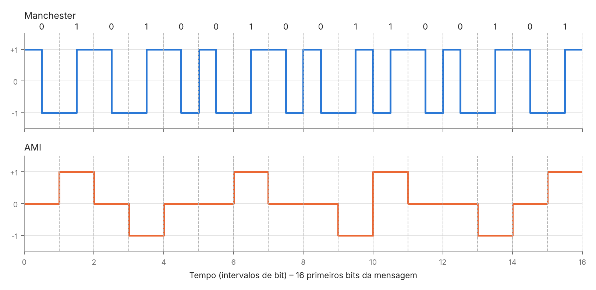
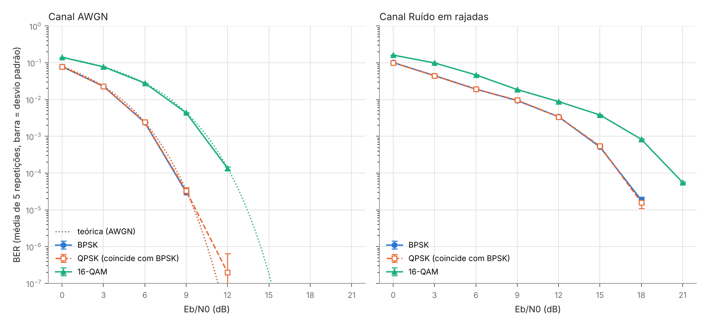
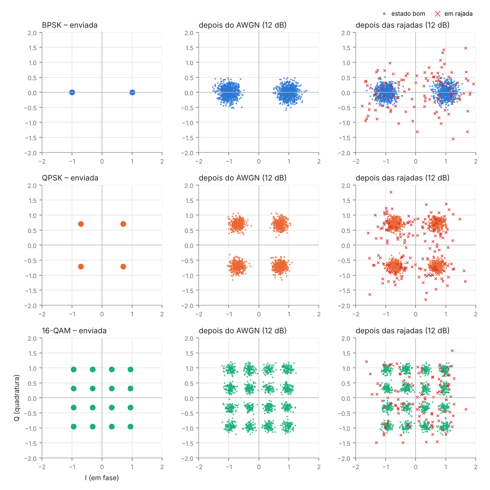
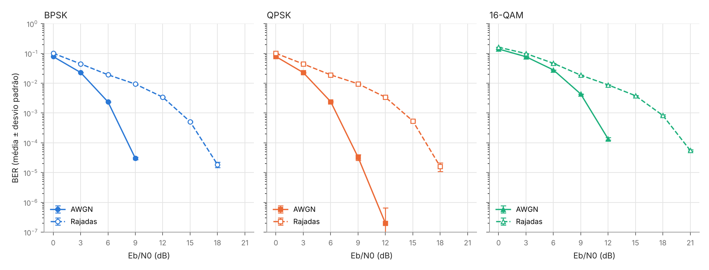
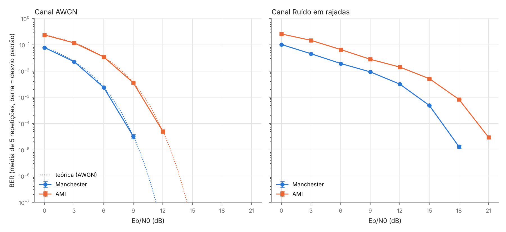
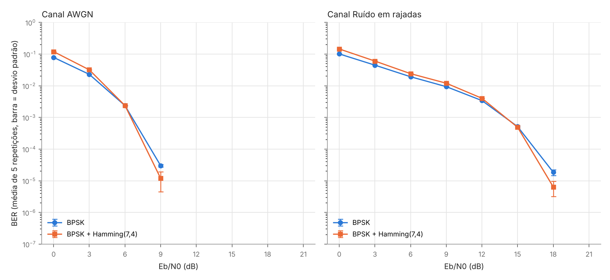

# Simulador de transmissão digital

Trabalho 2 de Redes de Computadores (UNISINOS, 2026/2) – Prof. Cristiano Bonato Both
Dupla: Thobias Ferreira Maciel e Lorrana Santos Lasch Moreira

Simulador ponta a ponta de um sistema de comunicação digital: uma mensagem ASCII vira bits, passa por codificação de linha ou modulação, atravessa um canal ruidoso, é demodulada e reconstruída. O simulador mede a taxa de erro de bits (BER) e a eficiência espectral e compara as técnicas em dois cenários de canal.

**Vídeo (até 5 min):** [colocar o link ou o arquivo em `docs/`]

## Arquitetura

```
mensagem ASCII
      │  src/dados.py        texto -> bits (8 bits por caractere)
      ▼
    bits ──────────────┬────────────────────────────────┐
      │                │                                │
      ▼                ▼                                ▼
 src/linha.py     src/modulacao.py              src/hamming.py (extra)
 Manchester, AMI  BPSK, QPSK, 16-QAM            Hamming(7,4) + BPSK
 (banda base)     (símbolos complexos)          (correção de erros)
      │                │                                │
      └────────────────┴───────────────┬────────────────┘
                                       ▼
                               src/canal.py
                     AWGN  ou  ruído em rajadas (Eb/N0 controlado)
                                       │
                                       ▼
                     demodulação / decodificação (mesmos módulos)
                                       │
                                       ▼
          bits recebidos -> mensagem reconstruída, bits errados marcados
                                       │
                                       ▼
                 src/metricas.py   BER, eficiência espectral, BER teórica
```

`src/enlace.py` junta tudo na função `transmitir(bits, esquema, canal, ebn0_db, rng)`, usada pela demonstração, pelos testes e pelos experimentos.

| Arquivo | O que faz |
|---|---|
| `simulador.py` | Demonstração: transmite uma mensagem e mostra o texto recebido e os bits errados |
| `src/dados.py` | ASCII ↔ bits, posições dos bits errados |
| `src/linha.py` | Codificações de linha Manchester e AMI |
| `src/modulacao.py` | BPSK, QPSK e 16-QAM (mapeamento de Gray) e demodulação |
| `src/canal.py` | Canal AWGN e canal com ruído em rajadas |
| `src/hamming.py` | Extra: código corretor Hamming(7,4) |
| `src/metricas.py` | BER, eficiência espectral nominal e curvas teóricas |
| `src/enlace.py` | Enlace completo (transmissor → canal → receptor) |
| `experimentos/config.json` | Todos os parâmetros dos experimentos |
| `experimentos/rodar_experimentos.py` | Roda os experimentos e grava os resultados brutos |
| `experimentos/gerar_graficos.py` | Gera resumo, tabelas e gráficos a partir dos resultados brutos |
| `tests/test_consistencia.py` | Teste de consistência (canal ideal e comparação com a teoria) |
| `resultados/` | Resultados brutos (CSV), resumo, tabelas e gráficos |
| `docs/roteiro_video.md` | Roteiro do vídeo |

## Instalação e execução

Requer Python 3.9 ou mais novo.

```
pip install -r requirements.txt

python simulador.py                                          # demonstração com a mensagem padrão
python simulador.py --esquema 16qam --canal rajadas --ebn0 9
python simulador.py --mensagem "Ola, mundo" --esquema manchester --ideal

python tests/test_consistencia.py                            # teste de consistência
python experimentos/rodar_experimentos.py                    # ~40 s, grava resultados/brutos/
python experimentos/gerar_graficos.py                        # grava resumo, tabelas e gráficos
```

Opções do `simulador.py`: `--esquema` (`manchester`, `ami`, `bpsk`, `qpsk`, `16qam`, `bpsk+hamming`), `--canal` (`awgn`, `rajadas`), `--ebn0` (dB), `--ideal` (sem ruído), `--mensagem`, `--semente`.

Exemplo de saída (`python simulador.py --esquema 16qam --canal rajadas --ebn0 9`):

```
Enviada : Redes de Computadores - UNISINOS 2026/2: simulador de transmissao digital
Recebida: Redes ee S??Q?tadoses m UNISINOS 202>+3: simulador de transmissao digital
               ^  ^^^^^    ^   ^             ^^^

Bits errados ....... 15 de 584 (BER = 0.0257)
Posicoes dos erros . 55, 75, 80, 88, 92, 95, 98, 103, 104, 108, 151, 177, 292, 301, 311
```

## Conceitos

**Codificação de linha × codificação de correção de erros.** A codificação de linha define *o formato do sinal* que representa cada bit no meio físico (níveis e transições). Ela resolve problemas como sincronismo e componente contínua, mas não acrescenta informação para corrigir erros. A codificação de correção de erros acrescenta *bits de redundância* aos dados para que o receptor detecte e corrija bits errados. As duas se complementam: o Hamming(7,4) incluído como extra age sobre os bits (4 bits de dados viram 7), antes de o sinal ser formado.

**Codificações de linha implementadas**
- Manchester: bit 1 = transição de baixo (−1) para alto (+1) no meio do bit; bit 0 = alto para baixo. Todo bit tem uma transição (bom para o sincronismo), mas são 2 níveis por bit, o que dobra a banda ocupada.
- AMI: bit 0 = nível 0; bit 1 = +1 e −1 alternados. Não tem componente contínua e usa 1 nível por bit, mas usa três níveis de sinal e uma sequência longa de zeros fica sem transições.



**Modulações implementadas** (banda base equivalente: cada símbolo é um número complexo, com energia média Es = 1)

| Modulação | Bits por símbolo | Pontos da constelação | Eficiência espectral nominal |
|---|---|---|---|
| BPSK | 1 | 2 | 1 bit/s/Hz |
| QPSK | 2 | 4 | 2 bit/s/Hz |
| 16-QAM | 4 | 16 | 4 bit/s/Hz |

A eficiência espectral é *nominal*: log2(M) bit/s/Hz, considerando filtro ideal de Nyquist (banda igual à taxa de símbolos, sem roll-off).

**Como as codificações de linha e as modulações entram no enlace.** A codificação de linha é uma transmissão em banda base e a modulação usa uma portadora; são formas alternativas de colocar os bits no canal. Por isso o simulador tem dois ramos que passam pelos mesmos canais e pelas mesmas métricas: o ramo de banda base (Manchester e AMI) e o ramo de modulação (BPSK, QPSK e 16-QAM).

**Canais**
- AWGN: ruído branco gaussiano somado ao sinal. O nível é controlado por Eb/N0 (energia por bit de informação sobre a densidade de ruído), em dB. Usar Eb/N0 mantém a comparação justa: todas as técnicas gastam a mesma energia por bit.
- Ruído em rajadas: modelo de dois estados (tipo Gilbert-Elliott). No estado bom o ruído é o do Eb/N0 configurado; no estado ruim (rajada) o ruído é 10 dB mais forte. A cada símbolo o canal entra em rajada com probabilidade 0,01 e sai com probabilidade 0,1; ou seja, rajadas de 10 símbolos em média, ocupando cerca de 9% do tempo.

## Plano experimental

Todos os parâmetros estão em `experimentos/config.json`.

| Parâmetro | Valor |
|---|---|
| Eb/N0 | 0, 3, 6, 9, 12, 15, 18 e 21 dB (8 valores, os mesmos para todas as técnicas e canais) |
| Bits por ponto | 1.000.000 de bits aleatórios por execução |
| Repetições | 5 por ponto, com sementes diferentes (2027 a 2031) |
| Esquemas | BPSK, QPSK, 16-QAM, Manchester, AMI e BPSK + Hamming(7,4) |
| Canais | AWGN e ruído em rajadas |
| Canal em rajadas | P(bom→ruim) = 0,01; P(ruim→bom) = 0,1; +10 dB de ruído na rajada |
| Total | 480 execuções, 480 milhões de bits |

**Por que 1.000.000 de bits em vez de 100.000.** A confiança em uma BER medida depende do número de erros observados. Com 100.000 bits, uma BER de 10⁻⁴ aparece como apenas ~10 erros. Com 1.000.000 de bits por execução (5.000.000 por ponto), ela aparece como ~100 erros por execução. A simulação completa leva cerca de 40 segundos.

**Reprodutibilidade.** As sementes são fixas, então rodar os dois scripts de novo gera os mesmos resultados. `resultados/brutos/ber_brutos.csv` tem uma linha por execução (esquema, canal, Eb/N0, repetição, semente, bits, erros e BER).

## Resultados

### Teste de consistência

`python tests/test_consistencia.py` (saída em `resultados/teste_consistencia.txt`) verifica que:
1. a conversão ASCII → bits → ASCII devolve a mensagem original;
2. em canal ideal (sem ruído) e em Eb/N0 = 40 dB, os seis esquemas recuperam a mensagem sem nenhum bit errado, nos dois canais;
3. em AWGN com Eb/N0 = 6 dB, a BER simulada fica próxima da teórica (por exemplo, 16-QAM: 0,0277 simulada e 0,0279 teórica).

Não houve divergências: todos os testes passaram.

### BER × Eb/N0 das modulações

Pontos = média das 5 repetições; barras = desvio padrão. As linhas pontilhadas são as curvas teóricas em AWGN. Pontos sem nenhum erro não aparecem (eixo logarítmico).



| Eb/N0 (dB) | BPSK (AWGN) | QPSK (AWGN) | 16-QAM (AWGN) | BPSK (rajadas) | QPSK (rajadas) | 16-QAM (rajadas) |
|---|---|---|---|---|---|---|
| 0 | 7,85e-02 | 7,86e-02 | 1,41e-01 | 1,01e-01 | 1,01e-01 | 1,62e-01 |
| 3 | 2,29e-02 | 2,27e-02 | 7,75e-02 | 4,47e-02 | 4,43e-02 | 9,90e-02 |
| 6 | 2,37e-03 | 2,41e-03 | 2,80e-02 | 1,92e-02 | 1,91e-02 | 4,67e-02 |
| 9 | 3,02e-05 | 3,30e-05 | 4,36e-03 | 9,37e-03 | 9,58e-03 | 1,87e-02 |
| 12 | 0 | 2,00e-07 | 1,36e-04 | 3,41e-03 | 3,39e-03 | 8,80e-03 |
| 15 | 0 | 0 | 0 | 5,13e-04 | 5,42e-04 | 3,81e-03 |
| 18 | 0 | 0 | 0 | 1,86e-05 | 1,60e-05 | 8,31e-04 |
| 21 | 0 | 0 | 0 | 0 | 0 | 5,58e-05 |

"0" = nenhum erro em 5.000.000 de bits. Isso não quer dizer BER nula: quer dizer BER abaixo de cerca de 6 × 10⁻⁷ (regra de três: 3 dividido pelo número de bits, com 95% de confiança). As tabelas completas, com os desvios, estão em `resultados/tabelas.md`.

O que os resultados mostram:
- **A simulação confere com a teoria.** Em AWGN os pontos caem sobre as curvas teóricas das três modulações.
- **BPSK e QPSK têm a mesma BER para o mesmo Eb/N0** (em 6 dB: 2,37 × 10⁻³ e 2,41 × 10⁻³). O QPSK é como dois BPSK independentes, um em cada eixo (I e Q), então transmite o dobro de bits na mesma banda sem custo em BER.
- **O 16-QAM paga pela eficiência.** Com 16 pontos, eles ficam mais próximos entre si para a mesma energia, e o ruído causa mais erros: em 9 dB a BER é 4,36 × 10⁻³, contra 3 × 10⁻⁵ do QPSK.

### Constelações antes e depois do canal



Em 12 dB, o AWGN espalha os pontos em nuvens ao redor das posições ideais. No BPSK e no QPSK as nuvens não chegam às fronteiras de decisão (os eixos), mas no 16-QAM elas já quase se tocam. No canal em rajadas, os símbolos atingidos por uma rajada (em vermelho) se espalham muito mais e cruzam as fronteiras, mesmo quando os demais símbolos chegam limpos.

### AWGN × ruído em rajadas



- **A rajada muda o formato da curva.** Em AWGN a BER despenca com o aumento de Eb/N0. Com rajadas ela cai devagar: os erros passam a ser dominados pelos 9% do tempo em que o canal está no estado ruim, onde o ruído é 10 dB mais forte.
- **Dá para conferir pelos números.** Em Eb/N0 alto, a BER com rajadas é aproximadamente 9% da BER que o AWGN teria com 10 dB a menos. BPSK em 15 dB: 0,091 × BER do AWGN em 5 dB (5,95 × 10⁻³) ≈ 5,4 × 10⁻⁴; o medido foi 5,13 × 10⁻⁴.
- **Custo em potência.** Para chegar a BER = 10⁻³ é preciso cerca de 7 dB a mais de Eb/N0 nas três modulações (tabela de compromisso abaixo).
- **Efeito na mensagem** (`resultados/brutos/mensagens.txt`). Em 9 dB com AWGN, a mensagem chega intacta com BPSK e QPSK e com 1 bit errado no 16-QAM. Em 9 dB com rajadas, os erros aparecem agrupados e trechos inteiros ficam ilegíveis:

```
QPSK, AWGN,    9 dB:  Redes de Computadores - UNISINOS 2026/2: simulador de transmissao digital
QPSK, rajadas, 9 dB:  Redes de Computadores - UMQ_?LMS 2026/2:"si}?lador de transmissao digital
```

### Variabilidade entre repetições

Coeficiente de variação (desvio padrão / média) das 5 repetições em AWGN; entre parênteses, o número médio de erros por repetição.

| Eb/N0 (dB) | BPSK | QPSK | 16-QAM |
|---|---|---|---|
| 0 | 0,1% (78.482) | 0,3% (78.600) | 0,1% (140.982) |
| 3 | 0,3% (22.915) | 0,7% (22.722) | 0,4% (77.537) |
| 6 | 1,1% (2.366) | 3,0% (2.414) | 0,4% (28.020) |
| 9 | 9,5% (30) | 21,7% (33) | 1,2% (4.357) |
| 12 | sem erros | 223,6% (0,2) | 9,5% (136) |

A variabilidade depende do número de erros contados, não da modulação. Com dezenas de milhares de erros as repetições diferem em menos de 1%. Com cerca de 30 erros a variação sobe para 10 a 20%. Com 1 único erro em 5 repetições (QPSK em 12 dB) o desvio é maior que a própria média, e esse ponto não é confiável. Por isso as barras de erro só aparecem na parte de baixo das curvas, e por isso usamos 1.000.000 de bits por execução.

### Compromisso entre BER e eficiência espectral

| Modulação | Eficiência nominal (bit/s/Hz) | BER em 6 dB (AWGN) | BER em 9 dB (AWGN) | BER em 12 dB (AWGN) | Eb/N0 para BER = 10⁻³ (AWGN) | Eb/N0 para BER = 10⁻³ (rajadas) |
|---|---|---|---|---|---|---|
| BPSK | 1 | 2,37e-03 | 3,02e-05 | 0 | ≈ 6,6 dB | ≈ 13,9 dB |
| QPSK | 2 | 2,41e-03 | 3,30e-05 | 2,00e-07 | ≈ 6,6 dB | ≈ 14,0 dB |
| 16-QAM | 4 | 2,80e-02 | 4,36e-03 | 1,36e-04 | ≈ 10,3 dB | ≈ 17,6 dB |

Os valores de Eb/N0 para BER = 10⁻³ são aproximados (interpolação entre os pontos simulados, que estão a cada 3 dB).

Quando cada modulação é mais adequada:
- **QPSK** é a melhor escolha quando o Eb/N0 é baixo ou moderado: tem a mesma BER do BPSK e o dobro da eficiência.
- **BPSK** só se justifica pela simplicidade ou quando a banda não é problema. Em um sistema real ele também tolera mais erro de fase, mas isso não foi simulado aqui.
- **16-QAM** dobra de novo a eficiência (4 bit/s/Hz), mas precisa de cerca de 3,7 dB a mais que o QPSK para a mesma BER de 10⁻³. Vale a pena quando a banda é limitada e o canal é bom: acima de ~10 dB em AWGN, ou acima de ~18 dB no canal com rajadas.
- **No canal com rajadas** todas as modulações precisam de ~7 dB a mais. Com Eb/N0 de 12 dB, por exemplo, o 16-QAM funcionaria bem em AWGN (BER 1,4 × 10⁻⁴) e mal com rajadas (8,8 × 10⁻³); ali o QPSK seria a escolha mais segura. É a lógica da modulação adaptativa usada em Wi-Fi e redes celulares: ordem alta quando o canal está bom, ordem baixa quando está ruim.

### Codificações de linha



- O Manchester tem a mesma BER do BPSK (os dois usam dois sinais opostos), mas ocupa o dobro da banda de um código com 1 nível por bit.
- O AMI precisa de cerca de 3 dB a mais para a mesma BER (BER = 10⁻³ perto de 10 dB, contra 6,6 dB do Manchester). O receptor tem de distinguir três níveis (−1, 0, +1) em vez de dois.
- No canal com rajadas os dois sofrem a mesma degradação vista nas modulações.

### Extra: Hamming(7,4)



Comparação com o mesmo Eb/N0 por bit de *informação* (os 3 bits de paridade gastam parte da energia).
- Em AWGN o código só ajuda em Eb/N0 alto: em 9 dB a BER cai de 3,0 × 10⁻⁵ para 1,2 × 10⁻⁵. Em Eb/N0 baixo ele piora (0 dB: 0,119 contra 0,078), porque cada bit transmitido tem menos energia e há mais de um erro por bloco.
- Com rajadas o ganho quase desaparece (só aparece a partir de 18 dB): a rajada coloca vários erros no mesmo bloco de 7 bits, e o Hamming só corrige 1. Em um sistema real isso se resolve com entrelaçamento (interleaving), que espalha os erros da rajada por blocos diferentes; não foi implementado.

## Conclusões

1. O simulador reproduz a teoria em AWGN, o que valida a implementação ponta a ponta.
2. Eficiência espectral custa energia: passar de QPSK para 16-QAM dobra a taxa na mesma banda e exige ~3,7 dB a mais de Eb/N0.
3. O tipo de ruído importa tanto quanto o nível: com rajadas em 9% do tempo, todas as técnicas precisam de ~7 dB a mais, e os erros chegam agrupados, destruindo trechos da mensagem.
4. Uma BER medida só é confiável com erros suficientes: abaixo de ~100 erros por execução a variação entre repetições chega a 10% ou mais.
5. Codificação de linha, modulação e correção de erros resolvem problemas diferentes (formato do sinal, uso da banda e proteção dos dados) e se combinam em um sistema real.

## Limitações

- Eficiência espectral nominal (filtro ideal, sem roll-off); a banda real ocupada não é simulada.
- Sem erros de sincronismo, de fase ou de frequência: o receptor conhece perfeitamente a portadora e o relógio.
- Demodulação por decisão rígida (ponto mais próximo); o Hamming não usa decisão suave nem entrelaçamento.
- No canal em rajadas, o Eb/N0 informado é o do estado bom; o Eb/N0 médio real é menor.

## Divisão de responsabilidades

| Parte | Responsável |
|---|---|
| Dados (ASCII ↔ bits), codificações de linha, canais AWGN e em rajadas | Thobias Ferreira Maciel |
| Modulações (BPSK, QPSK, 16-QAM), constelações e curvas teóricas | Lorrana Santos Lasch Moreira |
| Experimentos, análise dos resultados, README, vídeo e apresentação | Os dois |

## Ferramentas

Python 3, numpy e matplotlib. O código e a documentação foram desenvolvidos com apoio de IA (Claude, da Anthropic) e revisados pela dupla; os resultados foram validados pelo teste de consistência e pela comparação com as curvas teóricas.
